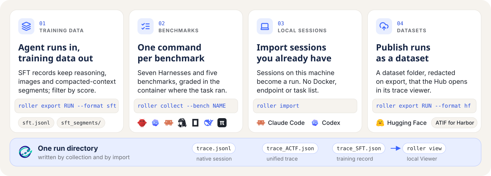
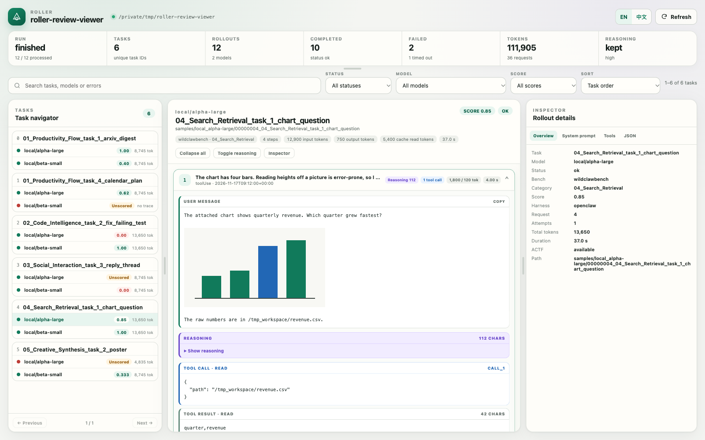
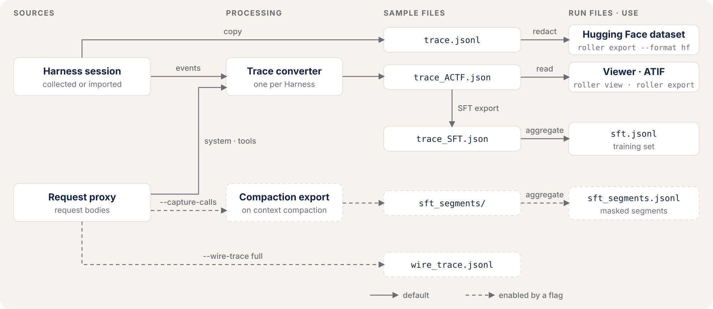
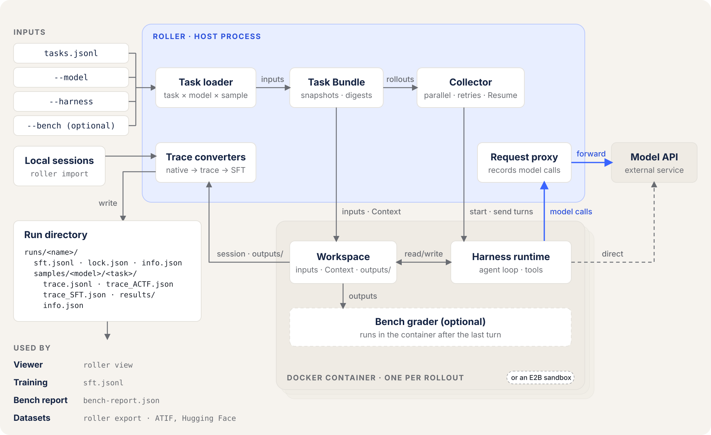
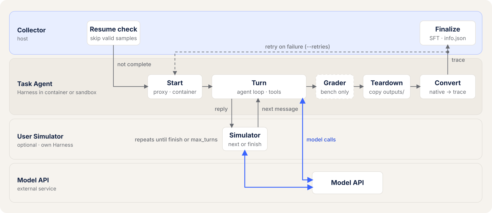

<p align="center">
  <picture>
    <source media="(prefers-color-scheme: dark)" srcset="assets/roller-logo-dark.png">
    
  </picture>
</p>
<h1 align="center">Roller</h1>
<p align="center"><strong>Collect, grade and publish agent trajectories</strong></p>
<p align="center">Roller runs Claude Code, Codex, OpenClaw and five other Harnesses on your tasks or on a benchmark, grades each sample, and imports the sessions already on your machine. Every run exports to SFT training data, XTuner, ATIF and a Hugging Face dataset.</p>

<p align="center">
  <a href="#harnesses"></a>
  <a href="#benchmarks"></a>
  <a href="https://pypi.org/project/roller-agent/"></a>
  <a href="https://huggingface.co/datasets/Valen-Team/Roller-WildClawBench-Trajectories"></a>
  <a href="https://github.com/Valen-Team/Roller/actions/workflows/tests.yml"></a>
  <a href="LICENSE"></a>
  <a href="pyproject.toml"></a>
</p>

<p align="center">
  <strong>English</strong> · <a href="README_zh-CN.md">简体中文</a><br>
  <a href="https://valen-team.github.io/roller/">Documentation</a> · <a href="https://valen-team.github.io/roller/start/getting-started/">Getting started</a> · <a href="https://valen-team.github.io/roller/start/cli-reference/">CLI reference</a> · <a href="https://valen-team.github.io/roller/cookbook/">Cookbook</a> · <a href="examples/README.md">Examples</a>
</p>

<p align="center">
  More from Valen Team: <a href="https://github.com/Valen-Team/Valen">Valen-Decision</a>, a multimodal System One decision model
</p>

<p align="center">
  <picture>
    <source media="(prefers-color-scheme: dark)" srcset="assets/diagrams/hero-en-dark.svg">
    
  </picture>
</p>

<p align="center">
  <a href="#what-roller-does">What Roller does</a> · <a href="#news">News</a> · <a href="#quick-start">Quick start</a> · <a href="#harnesses">Harnesses</a> · <a href="#benchmarks">Benchmarks</a> · <a href="#outputs">Outputs</a> · <a href="#architecture">Architecture</a> · <a href="#documentation">Docs</a> · <a href="#contributing">Contributing</a>
</p>

<a id="what-roller-does"></a>
<a id="introduction"></a>
<a id="highlights"></a>

## What Roller does

```bash
uv tool install roller-agent    # or: python -m pip install roller-agent
```

### 1. Agent runs in, training data out

Each successful rollout becomes a `messages` + `tools` record in `sft.jsonl`. The record keeps the visible reasoning of the model, and messages containing images use standard OpenAI multimodal content lists (`text` and `image_url` blocks). When the agent compacts its context, each verified context window is exported as its own record under `sft_segments/`. On a graded run, keep the samples above a score, or export directly to XTuner multimodal JSONL:

```bash
roller export runs/wildclaw --format sft --min-score 0.5 --output training
roller export runs/wildclaw --format xtuner --min-score 0.5 --output training-xtuner
```

[SFT format →](https://valen-team.github.io/roller/traces/sft-format/)

### 2. One command per benchmark

`roller collect --bench` converts the benchmark tasks, runs them on a compatible Harness (VIALS generates tasks for Stirrup; the other six run on container-based Harnesses), executes each grader in the sample's container or sandbox (or in the Roller process for offline VIALS containers), and writes `bench-report.json`. Adapters cover WildClawBench, SkillsBench, PinchBench, QwenClawBench, SWE-Bench Pro, VIALS and ZeroBench.

```bash
roller collect --bench wildclawbench --bench-root ~/WildClawBench \
  --model <provider>/<model> --model-config <models.json> \
  --harness openclaw --openclaw-image ghcr.io/valen-team/roller-wildclaw-base:1.3-clean.1 \
  --parallel 4 --output runs --run-name wildclaw
```

[Benchmarks ↓](#benchmarks)

<a id="import"></a>

### 3. Import the sessions you already have

`roller import` turns the Claude Code and Codex sessions on this machine into a run, one sample per session. No Docker, model endpoint or task list is needed.

```bash
roller import --dry-run                             # list the sessions by project
roller import --output runs --run-name my-sessions
roller view runs/my-sessions
```

Roller reads `~/.claude/projects`, `~/.codex/sessions` and `~/.codex/archived_sessions`, including compressed Codex sessions. `--harness`, `--since` and `--project` narrow the selection, and running the command again imports the new and changed sessions.

[Session import guide →](https://valen-team.github.io/roller/traces/import/)

### 4. Publish a run as a dataset

`roller export --format hf` packages a collected or imported run as a Hugging Face dataset folder that the Hub opens in its trace viewer. The export replaces the model endpoints, host names, host paths, home directories, user names and credential values of the run, and writes what it could not classify to `<output>.redaction-report.json`.

```bash
roller export runs/my-sessions --format hf --output my-sessions-hf
roller export runs/my-sessions                      # ATIF, the trajectory format of Harbor
```

Read the report, add `--redact-rules FILE` for what remains, and scan the folder with a secret scanner before uploading. [Roller-WildClawBench-Trajectories](https://huggingface.co/datasets/Valen-Team/Roller-WildClawBench-Trajectories) contains 1,680 attempts across OpenClaw, Codex, Claude Code, DeepSeek Harness and OpenCode. The [cookbook](https://valen-team.github.io/roller/cookbook/wildclawbench-open-models/) includes runnable collection recipes.

[Hugging Face export →](https://valen-team.github.io/roller/traces/trajectory-outputs/#hugging-face-export) · [ATIF export →](https://valen-team.github.io/roller/traces/trajectory-outputs/#atif-export)

### Browse every run in the Viewer

`roller view RUN_DIR` opens a read-only web interface for browsing tasks, comparing models and inspecting each step, with benchmark scores, score filters and user images.

<p align="center">
  <a href="assets/demo/viewer-trajectory.gif"></a>
  <a href="assets/demo/viewer-models.gif"></a>
  <a href="assets/demo/viewer.png"></a>
</p>
<p align="center"><sub>Recordings of the built-in Viewer using synthetic demonstration data. Left: the reasoning, tool calls and tool results of one rollout. Middle: one task compared across models. Right: the complete layout. Select an image to view it at full size.</sub></p>

<a id="news"></a>

## News

- **2026-11-27**: Roller 0.7.0. Adds the [Stirrup Harness](https://valen-team.github.io/roller/harnesses/stirrup-configuration/), remote sandbox execution for Claude Code (`--sandbox-provider`, optional `route_http`), the [VIALS](https://valen-team.github.io/roller/benches/vials/) and [ZeroBench](https://valen-team.github.io/roller/benches/zerobench/) bench adapters, OpenAI multimodal SFT records and `roller export --format xtuner`, `--training-files-only` compact runs, upgraded pinned versions across all eight Harnesses, and a decoupled layered module architecture.
- **2026-11-20**: Roller 0.6.0. Adds [token-in, token-out collection](https://valen-team.github.io/roller/traces/token-ids/) (`--token-ids` with `--capture-calls`, plus `roller export --format tokens`) across all Harnesses, proxy translation for Claude Code and Codex (`--claude-chat-completions`, `--codex-chat-completions`), and an OpenCode WildClawBench cookbook recipe.
- **2026-11-19**: Roller 0.5.0. `roller import` is on PyPI. DeepSeek Harness can collect WildClawBench in an [E2B sandbox](https://valen-team.github.io/roller/harnesses/deepseek-configuration/#e2b-for-wildclawbench) with `--sandbox-provider e2b`, for collectors without a Docker daemon. Collection checks credentials up front and logs progress and ETA, `roller clean` removes the containers of dead collectors, and `roller export --format sft --min-score` filters training data by score.
- **2026-11-18**: [Session import](https://valen-team.github.io/roller/traces/import/). `roller import` turns the Claude Code and Codex sessions on this machine into a Roller run that the Viewer and every export read like a collected one.
- **2026-11-17**: [WildClawBench with OpenClaw and Codex](https://valen-team.github.io/roller/cookbook/wildclawbench-open-models/): four self-hosted models, browsable trajectories and scores, public task images and runnable collection examples.
- **2026-11-16**: [Hugging Face export](https://valen-team.github.io/roller/traces/trajectory-outputs/#hugging-face-export) and [ATIF export](https://valen-team.github.io/roller/traces/trajectory-outputs/#atif-export). The first dataset is [Roller-WildClawBench-Trajectories](https://huggingface.co/datasets/Valen-Team/Roller-WildClawBench-Trajectories).
- **2026-11-15**: Roller is on PyPI as [`roller-agent`](https://pypi.org/project/roller-agent/). `roller init` writes the example tasks and configuration templates into the working directory.

<details>
<summary>Earlier</summary>

- **2026-11-11**: SFT export for compacted context. When the Task Agent compacts its context, each verified context window is exported as a separate SFT record under `sft_segments/`.
- **2026-11-08**: QwenClawBench adapter: 100 tasks in 8 domains, with automated grading, hybrid grading and repeated runs per task.
- **2026-11-05**: One-command evaluation for SkillsBench and PinchBench. SFT records support images.
- **2026-11-01**: Hermes, OpenCode, DeepSeek Harness and Pi Agent added, for a total of seven Harnesses.

</details>

The [changelog](CHANGELOG.md) lists every change of each release.

<a id="quick-start"></a>

## Quick start

The following procedure collects a first batch of trajectories with OpenClaw, the default Harness.

### 1. Installation

Requirements: Python 3.10 or later and a running Docker daemon. With Docker Desktop on macOS, enable **Enable host networking** under **Settings → Resources → Network** and restart Docker Desktop.

```bash
uv tool install roller-agent    # or: python -m pip install roller-agent
docker pull ghcr.io/openclaw/openclaw:2026.11.10
mkdir roller-quickstart && cd roller-quickstart
roller init                     # writes the example tasks and configuration templates
```

### 2. Model configuration

Copy the environment template, set `MY_PROXY_BASE_URL` and `MY_PROXY_API_KEY`, and export the variables to the current shell:

```bash
cp examples/env/api.env.example examples/env/api.env
# Edit examples/env/api.env, then export its variables:
set -a; source examples/env/api.env; set +a
```

In [`examples/config/openclaw/models.json`](examples/config/openclaw/models.json), set the model `id` to the model name used by the service. Commands reference a model as `<provider>/<id>`; with the example file, the model reference is `my-openai-proxy/my-model`. For services that support only `/chat/completions`, change `api` from `openai-responses` to `openai-completions`.

### 3. Collection

```bash
roller collect \
  --tasks examples/tasks/tasks.jsonl \
  --model my-openai-proxy/my-model \
  --model-config examples/config/openclaw/models.json \
  --parallel 4 --retries 1 --timeout 600 \
  --output runs --run-name quickstart
```

Add `--dry-run` first to parse the tasks, validate the input files and print the planned rollouts without starting containers or calling the model API. To compare models, repeat `--model`; each task then runs once per model.

### 4. Viewer

```bash
roller view runs/quickstart
```

Open the URL printed in the terminal (default `http://127.0.0.1:17865`).

### Long runs

- **Progress.** Collection checks the required credentials up front, logs progress, ETA and heartbeats to `collect.log`, and stops dispatch after 10 consecutive errors (`--max-consecutive-errors 0` disables this).
- **Resume.** Rerun the same command with `--resume` to skip the completed samples. Tasks and models can be added; if another setting recorded in `lock.json` has changed, Roller reports the difference and exits.
- **Grading failures.** Failed graders retry in the live container, and `--resume --resume-unscored` reruns the agents whose grading failed.
- **Leftovers.** `roller clean RUN_DIR --dry-run` lists the containers left by dead collectors.

[Getting started guide →](https://valen-team.github.io/roller/start/getting-started/)

<a id="harnesses"></a>

## Harnesses

A Harness is the agent runtime inside the container. It starts the agent, provides its tools and calls the model API. Specify the Harness for all tasks with `--harness`, or for an individual task with the `harness` field. All eight read the same task format and write the same sample layout.

| Harness | Model API | Description |
| --- | --- | --- |
| OpenClaw (default) | OpenAI Responses or Chat Completions | Custom and open models; multimodal input |
| Codex | Responses | Codex CLI with GPT or Responses-compatible services |
| Claude Code | Anthropic `/v1/messages` | Claude Code with native thinking |
| Hermes | OpenAI Chat Completions | Hermes Agent with terminal and file tools |
| OpenCode | OpenAI Chat Completions | OpenCode CLI sessions with text and file tools |
| DeepSeek Harness | DeepSeek Chat Completions | Official SDK with a single persistent Bash tool |
| Pi Agent | OpenAI Chat Completions | Pi SDK with seven tools: `read`, `bash`, `edit`, `write`, `grep`, `find`, `ls` |
| Stirrup | OpenAI Chat Completions | Stirrup 0.2.2 with `code_exec`, `view_image` and `finish`; the agent runs in the Roller process and the container executes its code |

### Capability matrix

| Harness | Docker | Remote sandbox | User Simulator | `--capture-calls` & `--token-ids` | `roller import` | Prebuilt image |
| --- | --- | --- | --- | --- | --- | --- |
| OpenClaw | Yes | — | Yes | Yes | — | Upstream (`ghcr.io/openclaw/openclaw:2026.11.10`) |
| Codex | Yes | — | Yes | Yes (`--codex-chat-completions` for `--token-ids`) | Yes (`~/.codex`) | `ghcr.io/valen-team/roller-codex:0.172.0` |
| Claude Code | Yes | Yes (`--sandbox-provider`) | Yes | Yes (`--claude-chat-completions` for `--token-ids`) | Yes (`~/.claude`) | Build locally (`docker/claude-code`) |
| Hermes | Yes | — | Yes | Yes | — | `ghcr.io/valen-team/roller-hermes:8fc037444731` |
| OpenCode | Yes | — | Yes | Yes | — | `ghcr.io/valen-team/roller-opencode:1.19.6` |
| DeepSeek Harness | Yes | WildClawBench only (`e2b` / `roller.sandbox_providers`) | Yes | Yes | — | `ghcr.io/valen-team/roller-deepseek:0.2.2rc2` |
| Pi Agent | Yes | — | Yes | Yes | — | `ghcr.io/valen-team/roller-pi:1.6.1` |
| Stirrup | Yes | Yes (`roller.sandbox_providers`) | — | Yes | — | Base image (`python:3.13-slim`) |

OpenClaw reads model definitions from `--model-config`. The other seven Harnesses use `--api-base` and `--api-key-env`; in runs that combine several Harnesses, each takes its own prefixed pair, for example `--hermes-api-base` and `--hermes-api-key-env`. Every Harness except Stirrup can serve as the Task Agent or as the [User Simulator](https://valen-team.github.io/roller/tasks/user-simulator/), a second model that plays the user and writes the next turn.

Stirrup runs one prompt per task. It needs Python 3.12 or later and the `stirrup` extra (`pip install 'roller-agent[stirrup]'`). The extra cannot be installed together with the `pdf` extra. Its options set the request: `--stirrup-max-steps`, `--stirrup-context-length` (history is summarized at 70% of it), `--stirrup-output-tokens` (`max_tokens`), `--stirrup-command-timeout`, `--stirrup-temperature`, `--stirrup-top-p`, `--stirrup-seed` (each sample's seed is derived from it, the task ID and the sample index) and `--stirrup-request-set KEY=JSON` for further request fields; `--thinking` goes to `chat_template_kwargs.reasoning_effort`. The image only needs bash, GNU coreutils and the task's software; the default is `python:3.13-slim`.

Rollouts run in Docker containers. DeepSeek Harness can also run WildClawBench in an E2B sandbox: install `roller-agent[e2b]` and pass `--sandbox-provider e2b --sandbox-template NAME`, as the [DeepSeek guide](https://valen-team.github.io/roller/harnesses/deepseek-configuration/#e2b-for-wildclawbench) describes. Stirrup can run in a remote sandbox too: a provider package registers under the `roller.sandbox_providers` entry point, `--sandbox-provider NAME --sandbox-template NAME` select it and its environment, and the agent stays in the Roller process while the sandbox executes its commands. Claude Code runs in one as the CLI itself, started from the release the template mounts (`--claude-sandbox-binary` for another path). A sandbox created without egress cannot reach the request recording proxy, so the provider's optional `route_http` carries the CLI's requests out through the sandbox API; the proxy itself stays on the collecting host, and `--wire-trace full`, `--capture-calls` and `--token-ids` write what they write under Docker.

Harness guides: [OpenClaw](https://valen-team.github.io/roller/harnesses/openclaw-configuration/) · [Codex](https://valen-team.github.io/roller/harnesses/codex-configuration/) · [Claude Code](https://valen-team.github.io/roller/harnesses/claude-code-configuration/) · [Hermes](https://valen-team.github.io/roller/harnesses/hermes-configuration/) · [OpenCode](https://valen-team.github.io/roller/harnesses/opencode-configuration/) · [DeepSeek](https://valen-team.github.io/roller/harnesses/deepseek-configuration/) · [Pi Agent](https://valen-team.github.io/roller/harnesses/pi-configuration/) · [Stirrup](https://valen-team.github.io/roller/harnesses/stirrup-configuration/).

<a id="benchmarks"></a>

## Benchmarks

Bench adapters convert benchmark tasks into Roller tasks and grade each sample in the container where it ran; VIALS, whose containers have no network, grades a copy of the answer file in the Roller process. Grading failures are recorded separately from zero scores, and `bench-report.json` aggregates each model with failed samples in the denominator.

| Bench | Default Harness | Scope |
| --- | --- | --- |
| [WildClawBench](https://valen-team.github.io/roller/benches/wildclawbench/) | `openclaw` | 60 real-scenario tasks in 6 categories |
| [SkillsBench](https://valen-team.github.io/roller/benches/skillsbench/) | `opencode` | One built environment per task; with-skill and no-skill runs scored by official verifiers |
| [PinchBench](https://valen-team.github.io/roller/benches/pinchbench/) | `openclaw` | Automated, LLM-judge, hybrid and multi-session tasks |
| [QwenClawBench](https://valen-team.github.io/roller/benches/qwenclawbench/) | `openclaw` | 100 tasks in 8 domains, with repeated runs per task |
| [SWE-Bench Pro](https://valen-team.github.io/roller/benches/swebench-pro/) | `openclaw` | 731 software-engineering tasks in 11 repositories, scored by hidden tests in official instance images |
| [VIALS](https://valen-team.github.io/roller/benches/vials/) ([cookbook](examples/cookbook/vials-stirrup)) | `stirrup` | 161 scientific image questions answered with code execution, judged by an LLM; pass^3, avg@3 and pass@3 over three samples |
| [ZeroBench](https://valen-team.github.io/roller/benches/zerobench/) ([cookbook](examples/cookbook/zerobench-claude-code)) | `claude-code` | The 100 main questions or the 334 sub-questions, images as files the agent crops and views; the official strict `{final answer}` rule scores them without a judge, with avg@k and pass@k over k samples |

A bench run starts with `roller collect --bench`, as in [One command per benchmark](#what-roller-does), or from a YAML file with `roller bench run --config ...`; see [Benchmark run configuration](https://valen-team.github.io/roller/benches/benchmark-standard/). Each bench guide lists the settings that must match the upstream configuration and the environment variables required by its graders. To add a bench, see [Bench integration and scoring](https://valen-team.github.io/roller/benches/bench-format/#6-adding-a-new-bench).

<a id="tasks"></a>

## Tasks

A task is a JSON object. A minimal task contains a schema version, an ID and a prompt:

```json
{"schema_version":"roller.task/v1","id":"hello","prompt":"Compute 2+3. Reply with the number only."}
```

A task list can be a `.jsonl` file, a JSON array or an object of the form `{"tasks": [...]}`. Optional fields add predefined user turns (`messages`), input and Context files (`files`), an output directory that Roller collects in full (`files.output_dir`), environment and setup commands (`runtime`), a Harness for this task (`harness`) and a `user_simulator`. The [task format reference](https://valen-team.github.io/roller/tasks/task-format/) specifies every field.

<a id="outputs"></a>

## Outputs

Each run is stored in one directory. Run-level files are at the top level, and each sample has its own directory under `samples/`:

```text
runs/quickstart/
├── info.json            settings, progress and total usage
├── lock.json            settings compared by --resume
├── sft.jsonl            SFT records of successful, uncompacted samples
├── sft_index.jsonl      task, model and score for each training record
└── samples/<model>/<index>_<task>/
    ├── trace.jsonl      Harness-native session
    ├── trace_ACTF.json  unified trace: reasoning, tool calls, results, tokens, timing
    ├── trace_SFT.json   SFT record of this sample
    ├── info.json        status, attempts, usage, versions and input digests
    └── results/         files written to the task's output directory
```

Use `sft.jsonl` for training and `trace_ACTF.json` for analysis. `trace.jsonl` retains the Harness-native events for debugging and re-conversion and is not cleaned for training.

The following figure shows how each file is produced. Dashed paths are enabled by the flag shown on the arrow.

<p align="center">
  <a href="assets/diagrams/pipeline-en-light.svg"><picture>
    <source media="(prefers-color-scheme: dark)" srcset="assets/diagrams/pipeline-en-dark.svg">
    
  </picture></a>
</p>

Three files are written only under specific conditions:

- `sft_segments/`: written when the Task Agent compacts its context. The rollout is then left out of `sft.jsonl`, and each verified context window is a separate record whose `target_start_index` marks the first supervised message.
- `wire_trace.jsonl`: written with `--wire-trace full`. It contains every request body that Roller's proxy forwarded to the model API. Each image is stored once in the sample's `blobs/` directory and referenced from the request bodies, here and in the captured Calls of `--capture-calls`; Roller restores the original data URIs when it reads them.
- `conversation.json`: written for User Simulator tasks. It contains the dialogue visible to both participants.

`--training-files-only` keeps only what training needs once a sample has finished and been graded: `trace_SFT.json` or `sft_segments/`, `token_ids.jsonl`, `info.json` and `score.json`, with each image of the SFT records stored once for the whole run, in the run directory's `blobs/`. It also removes the files that `--wire-trace full` and `--capture-calls` keep, after the context windows have been cut from the Calls. The run-level `sft.jsonl` is not written; `roller export --format sft`, `--format xtuner` and `--format tokens` give the same output as for the run collected without the option. Such a run cannot be opened in the Viewer, exported to Hugging Face or ATIF, or have its SFT rebuilt. Samples that failed, or whose grading failed, keep all their files for `--resume`.

`--keep-thinking` is on by default and stores the visible reasoning that the model service returns; `--thinking` sets the requested reasoning level. The [trajectory output guide](https://valen-team.github.io/roller/traces/trajectory-outputs/) specifies when each file is written, and the [SFT format](https://valen-team.github.io/roller/traces/sft-format/) describes the training records.

<a id="architecture"></a>

## Architecture

Roller runs as a single host process. The Collector schedules rollouts in parallel and starts one Docker container, or one E2B sandbox, per rollout. Inside it, the Harness runtime executes the agent loop in a workspace that contains the declared inputs and Context. Depending on the Harness and the `--wire-trace` setting, model requests either pass through Roller's request proxy, which records them before forwarding, or go directly to the model API. After the last turn, Roller collects the native session and the output directory, and the trace converters write the sample to the run directory. `roller import` feeds local sessions to the same converters without a container.

<p align="center">
  <a href="assets/diagrams/architecture-en-light.svg"><picture>
    <source media="(prefers-color-scheme: dark)" srcset="assets/diagrams/architecture-en-dark.svg">
    
  </picture></a>
</p>
<p align="center"><sub>Blue arrows: model calls. Dashed elements: optional components and conditional paths.</sub></p>

Each rollout follows the lifecycle below. The Collector first checks whether a valid sample already exists. Otherwise it starts the container, and the Harness executes the turns; with a User Simulator, each Task Agent reply goes to the Simulator, which returns the next user message or ends the conversation. For bench runs, the grader runs before teardown. Roller then converts the native session to the normalized trace, and the Collector either retries a failed attempt (up to `--retries` times) or finalizes the sample.

<p align="center">
  <a href="assets/diagrams/lifecycle-en-light.svg"><picture>
    <source media="(prefers-color-scheme: dark)" srcset="assets/diagrams/lifecycle-en-dark.svg">
    
  </picture></a>
</p>

Roller snapshots and hashes all inputs before a container starts, and `lock.json` records the settings that determine sample content, so a resumed run produces the samples the first run would have.

<a id="documentation"></a>

## Documentation

New users should start with [Getting started](https://valen-team.github.io/roller/start/getting-started/) and refer to [Task format](https://valen-team.github.io/roller/tasks/task-format/) when writing tasks. The complete handbook is at [valen-team.github.io/roller](https://valen-team.github.io/roller/).

| Guide | Contents |
| --- | --- |
| [Introduction](https://valen-team.github.io/roller/start/introduction/) | Core concepts: task, Harness, rollout, run and trace |
| [Getting started](https://valen-team.github.io/roller/start/getting-started/) | Installation, dry run, first collection and result verification |
| [CLI reference](https://valen-team.github.io/roller/start/cli-reference/) | All flags, their defaults and the Harnesses they apply to |
| [Docker builds and package mirrors](https://valen-team.github.io/roller/start/docker-builds/) | apt, npm and Python mirrors and proxies for image builds |
| [Task format](https://valen-team.github.io/roller/tasks/task-format/) | Prompts, multi-turn messages, inputs, Context and output directories |
| [Files, Task Bundles and result storage](https://valen-team.github.io/roller/tasks/task-bundle-and-storage/) | Input snapshots, run layout, retries and Resume |
| [User Simulator](https://valen-team.github.io/roller/tasks/user-simulator/) | Dynamic conversations driven by a second model |
| [Trajectory outputs](https://valen-team.github.io/roller/traces/trajectory-outputs/) | Output files and their conditions; comparison of raw, normalized, SFT and wire traces |
| [SFT format](https://valen-team.github.io/roller/traces/sft-format/) | Record structure, images and compaction segments |
| [Viewer](https://valen-team.github.io/roller/traces/viewer/) | Startup, ports and remote access |
| [Session import](https://valen-team.github.io/roller/traces/import/) | Importing local Claude Code and Codex sessions, and redacting them for upload |
| [Token ids and logprobs](https://valen-team.github.io/roller/traces/token-ids/) | Collecting the token ids and logprobs of every model call, and exporting them as sequences |
| [Bench integration and scoring](https://valen-team.github.io/roller/benches/bench-format/) | Bench runs, grading and new bench adapters |
| [Examples](examples/README.md) (Chinese) | Runnable commands for each Harness |
| [Coverage suite](examples/coverage/README.en.md) | 1,624 functional test tasks across all seven Harnesses |

<a id="security"></a>

## Security and privacy

- Before a container starts, Roller rejects inputs and Context that contain symlinks or special files, escape their declared paths or exceed the size limits, and records a digest of every file.
- API keys are read from the host environment or from external configuration and are not written to run metadata.
- Only regular files and directories inside the task's `output_dir` are collected.
- `wire_trace.jsonl` and `blobs/` store the full requests, including prompts, reasoning, tool results and images. Treat them as sensitive data.
- The Viewer listens on `127.0.0.1` by default. Use SSH port forwarding for remote access.

The complete rules are specified in [Security and privacy boundaries](https://valen-team.github.io/roller/tasks/task-bundle-and-storage/#8-security-and-privacy-boundaries).

<a id="contributing"></a>

## Contributing

Report defects through [Issues](https://github.com/Valen-Team/Roller/issues). New Harnesses, new benches and documentation improvements are accepted as [Pull Requests](https://github.com/Valen-Team/Roller/pulls). The code is organized as follows:

| Area | Location |
| --- | --- |
| Command line & option specs | `src/roller/cli/`, `src/roller/option_specs.py` |
| Execution backends | `src/roller/docker_runtime.py`, `src/roller/execution.py`, `src/roller/sandbox*.py` |
| Harness adapters | `src/roller/harnesses/`, with trace converters in `src/roller/actf/` |
| Bench adapters | `src/roller/benches/` |
| SFT & XTuner export | `src/roller/sft.py`, `src/roller/compaction_sft.py`, `src/roller/xtuner_dataset.py` |
| ATIF & Hugging Face export | `src/roller/atif.py`, `src/roller/hf_dataset.py`, `src/roller/hf_redaction.py` |
| Viewer | `src/roller/viewer/` |

Run the checks before submitting a pull request:

```bash
python -m pip install -e ".[test]" ruff
python -m pytest
ruff check
ruff format --check
```

[CONTRIBUTING.md](CONTRIBUTING.md) describes the conventions for tests, documentation and the run lock, and [CHANGELOG.md](CHANGELOG.md) lists the changes in each release. Report a vulnerability as described in [SECURITY.md](SECURITY.md). Participation is covered by the [Code of Conduct](CODE_OF_CONDUCT.md).

### Contributors

<table>
  <tr>
    <td align="center">
      <a href="https://github.com/Liuziyu77"><br><sub><b>Liuziyu77</b></sub></a>
    </td>
    <td align="center">
      <a href="https://github.com/yph22"><br><sub><b>yph22</b></sub></a>
    </td>
    <td align="center">
      <a href="https://github.com/SYuan03"><br><sub><b>SYuan03</b></sub></a>
    </td>
    <td align="center">
      <a href="https://github.com/Dodojordi"><br><sub><b>Dodojordi</b></sub></a>
    </td>
    <td align="center">
      <a href="https://github.com/Nina-Hyn"><br><sub><b>Nina-Hyn</b></sub></a>
    </td>
    <td align="center">
      <a href="https://github.com/Credica"><br><sub><b>Credica</b></sub></a>
    </td>
  </tr>
  <tr>
    <td align="center">
      <a href="https://github.com/Orion-DH"><br><sub><b>Orion-DH</b></sub></a>
    </td>
    <td align="center">
      <a href="https://github.com/MqLeet"><br><sub><b>MqLeet</b></sub></a>
    </td>
    <td align="center">
      <a href="https://github.com/llreda"><br><sub><b>llreda</b></sub></a>
    </td>
    <td align="center">
      <a href="https://github.com/yuhangzang"><br><sub><b>yuhangzang</b></sub></a>
    </td>
    <td align="center">
      <a href="https://github.com/arpitgoswami"><br><sub><b>arpitgoswami</b></sub></a>
    </td>
    <td align="center">
      <a href="https://github.com/s1reyash"><br><sub><b>s1reyash</b></sub></a>
    </td>
  </tr>
  <tr>
    <td align="center">
      <a href="https://github.com/Aadithya-kl"><br><sub><b>Aadithya-kl</b></sub></a>
    </td>
  </tr>
</table>

<a id="more-from-valen-team"></a>

## More from Valen Team

Roller is one of the open-source projects of [Valen Team](https://github.com/Valen-Team), which works on fast decision models, recursive self-improvement (RSI) and agents.

[Valen-Decision](https://github.com/Valen-Team/Valen) is a multimodal System One decision model: text, images and video in; structured decision probabilities out. It comes in five sizes from 0.8B to 27B, answers bbox questions, and has a [web demo and free API](https://valen-team.github.io/).

<a id="license-and-acknowledgements"></a>

## License and acknowledgements

Roller is licensed under the [Apache License 2.0](LICENSE).

Roller invokes the following third-party agent runtimes and benchmarks: OpenClaw, Codex, Claude Code, Hermes Agent, OpenCode, DeepSeek Harness, Pi Agent, Stirrup, WildClawBench, SkillsBench, PinchBench, QwenClawBench, SWE-Bench Pro, VIALS and ZeroBench. Their images, code and data are subject to their respective licenses. We thank the authors of these projects.

<a id="citation"></a>

## Citation

If you use Roller in your work, please cite this repository:

```bibtex
@misc{roller,
  author       = {{Valen Team}},
  title        = {Roller},
  howpublished = {GitHub - Valen-Team/Roller: Agent trajectory collection across models and Harnesses.},
  note         = {GitHub repository},
  year         = {2026},
  url          = {https://github.com/Valen-Team/Roller}
}
```
