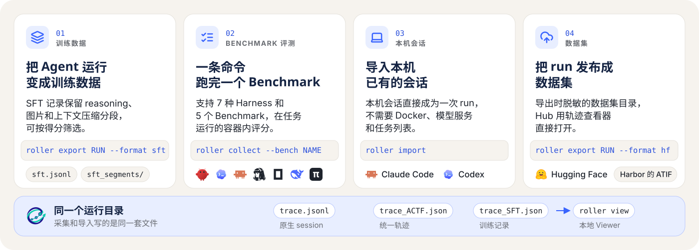
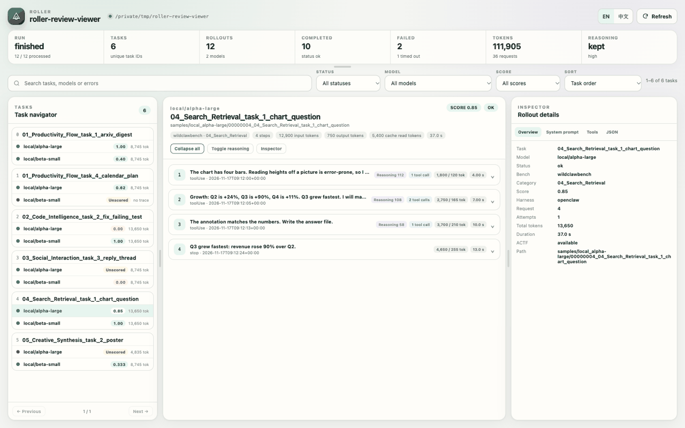
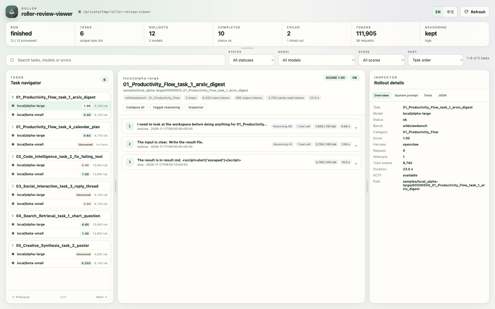
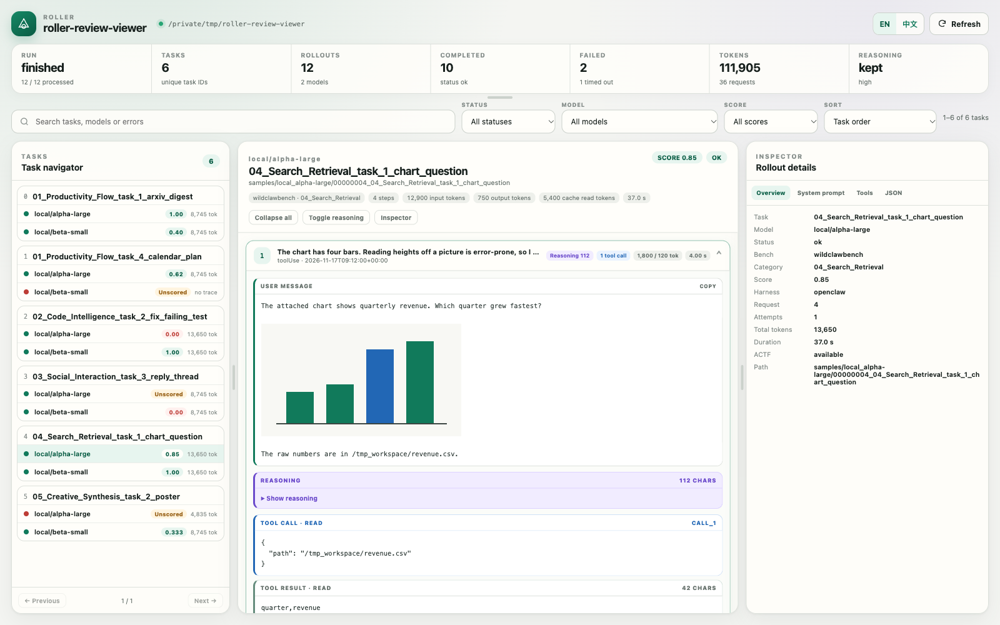
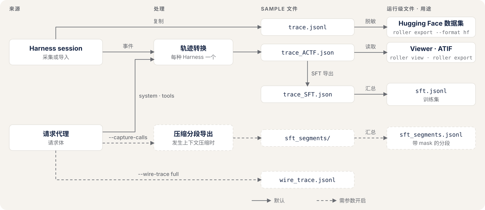
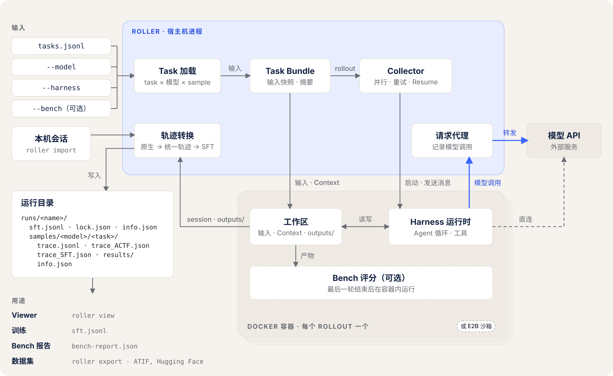
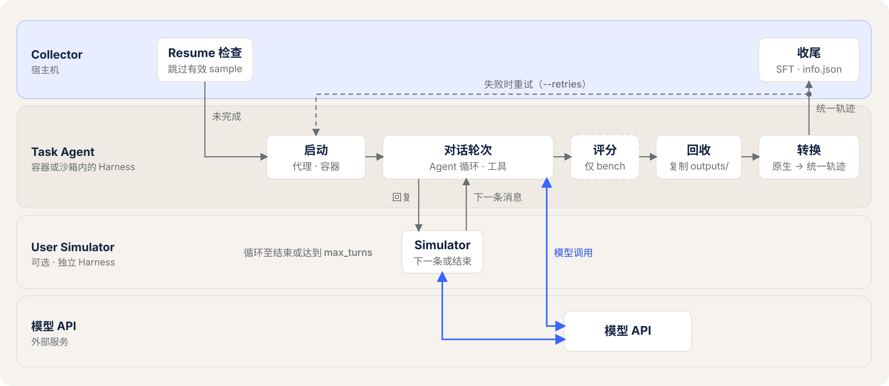

<p align="center">
  <picture>
    <source media="(prefers-color-scheme: dark)" srcset="assets/roller-logo-dark.png">
    
  </picture>
</p>
<h1 align="center">Roller</h1>
<p align="center"><strong>采集、评测并发布 Agent 轨迹</strong></p>
<p align="center">Roller 在你的 task 或 Benchmark 上运行 Claude Code、Codex、OpenClaw 等 7 种 Harness，在各 sample 的运行容器内完成评分，也能导入本机已有的会话。每次 run 都可以导出为 SFT 训练数据、ATIF 和 Hugging Face 数据集。</p>

<p align="center">
  <a href="#harnesses"></a>
  <a href="#benchmarks"></a>
  <a href="https://pypi.org/project/roller-agent/"></a>
  <a href="https://huggingface.co/datasets/Valen-Team/Roller-WildClawBench-Trajectories"></a>
  <a href="https://github.com/Valen-Team/Roller/actions/workflows/tests.yml"></a>
  <a href="LICENSE"></a>
  <a href="pyproject.toml"></a>
</p>

<p align="center">
  <a href="README.md">English</a> · <strong>简体中文</strong><br>
  <a href="https://valen-team.github.io/zh-Hans/roller/">文档</a> · <a href="https://valen-team.github.io/zh-Hans/roller/start/getting-started/">快速上手</a> · <a href="https://valen-team.github.io/zh-Hans/roller/start/cli-reference/">CLI 参数</a> · <a href="https://valen-team.github.io/zh-Hans/roller/cookbook/">Cookbook</a> · <a href="examples/README.md">示例</a>
</p>

<p align="center">
  Valen Team 的更多项目：<a href="https://github.com/Valen-Team/Valen/blob/main/README_zh.md">Valen-Decision</a>，多模态 System One 决策模型
</p>

<p align="center">
  <picture>
    <source media="(prefers-color-scheme: dark)" srcset="assets/diagrams/hero-zh-dark.svg">
    
  </picture>
</p>

<p align="center">
  <a href="#what-roller-does">Roller 能做什么</a> · <a href="#news">最新动态</a> · <a href="#quick-start">快速开始</a> · <a href="#harnesses">Harness</a> · <a href="#benchmarks">Benchmark</a> · <a href="#outputs">产物</a> · <a href="#architecture">架构</a> · <a href="#documentation">文档</a> · <a href="#contributing">参与贡献</a>
</p>

<a id="what-roller-does"></a>
<a id="introduction"></a>
<a id="highlights"></a>

## Roller 能做什么

```bash
uv tool install roller-agent    # 或：python -m pip install roller-agent
```

### 1. 把 Agent 运行变成训练数据

每个成功的 rollout 在 `sft.jsonl` 中生成一条 `messages` + `tools` 记录。记录保留模型的可见 reasoning，包含图片的消息采用标准 OpenAI 多模态内容列表（`text` 与 `image_url` 块）。Agent 压缩上下文时，每段通过校验的上下文窗口作为独立记录导出至 `sft_segments/`。对评过分的 run，可以按得分筛选，或一键导出为 XTuner 多模态 JSONL（已在 `main` 上，随下一个版本发布）：

```bash
roller export runs/wildclaw --format sft --min-score 0.5 --output training
roller export runs/wildclaw --format xtuner --min-score 0.5 --output training-xtuner
```

[SFT 数据格式 →](https://valen-team.github.io/zh-Hans/roller/traces/sft-format/)

### 2. 一条命令跑完一个 Benchmark

`roller collect --bench` 转换 Benchmark 任务，用 8 种 Harness 中的任意一种执行，在任务运行的容器内执行评分程序，并写出 `bench-report.json`。已适配 WildClawBench、SkillsBench、PinchBench、QwenClawBench、SWE-Bench Pro 和 VIALS。

```bash
roller collect --bench wildclawbench --bench-root ~/WildClawBench \
  --model <provider>/<model> --model-config <models.json> \
  --harness openclaw --openclaw-image ghcr.io/valen-team/roller-wildclaw-base:1.3-clean.1 \
  --parallel 4 --output runs --run-name wildclaw
```

[Benchmark ↓](#benchmarks)

<a id="import"></a>

### 3. 导入本机已有的会话

`roller import` 把本机的 Claude Code 和 Codex 会话导入成一次 run，每个会话生成一个 sample。不需要 Docker、模型服务和任务列表。

```bash
roller import --dry-run                             # 按项目列出会话
roller import --output runs --run-name my-sessions
roller view runs/my-sessions
```

Roller 读取 `~/.claude/projects`、`~/.codex/sessions` 和 `~/.codex/archived_sessions`，包括压缩的 Codex 会话。`--harness`、`--since`、`--project` 用于筛选，再次运行会导入新增和有变化的会话。

[会话导入指南 →](https://valen-team.github.io/zh-Hans/roller/traces/import/)

### 4. 把一次 run 发布成数据集

`roller export --format hf` 把采集或导入的 run 打包成 Hugging Face 数据集目录，Hub 用轨迹查看器直接打开。导出时替换 run 的模型端点、主机名、主机路径、home 目录、用户名和凭据取值，无法归类的残留写入 `<output>.redaction-report.json`。

```bash
roller export runs/my-sessions --format hf --output my-sessions-hf
roller export runs/my-sessions                      # ATIF，Harbor 的轨迹格式
```

上传前查看这份报告，用 `--redact-rules FILE` 补充规则，再用密钥扫描工具扫一遍输出目录。[Roller-WildClawBench-Trajectories](https://huggingface.co/datasets/Valen-Team/Roller-WildClawBench-Trajectories) 收录 OpenClaw、Codex、Claude Code、DeepSeek Harness 和 OpenCode 的 1,680 次尝试，[Cookbook](https://valen-team.github.io/zh-Hans/roller/cookbook/wildclawbench-open-models/) 提供可运行的采集示例。

[Hugging Face 导出 →](https://valen-team.github.io/zh-Hans/roller/traces/trajectory-outputs/#hugging-face-export) · [ATIF 导出 →](https://valen-team.github.io/zh-Hans/roller/traces/trajectory-outputs/#atif-export)

### 用 Viewer 浏览每次 run

`roller view RUN_DIR` 打开只读 Web 界面，用于浏览 task、对比模型和查看每个 step，支持 Benchmark 得分、得分筛选和用户消息图片。

<p align="center">
  <a href="assets/demo/viewer-trajectory.gif"></a>
  <a href="assets/demo/viewer-models.gif"></a>
  <a href="assets/demo/viewer.png"></a>
</p>
<p align="center"><sub>以上内容使用合成演示数据录制自内置 Viewer。左：单个 rollout 的 reasoning、工具调用和工具结果；中：同一 task 在多个模型间的对比；右：完整界面。点击图片可查看原图。</sub></p>

<a id="news"></a>

## 最新动态

- **2026-11-19**：Roller 0.5.0。`roller import` 已随 PyPI 版本发布。DeepSeek Harness 可以用 `--sandbox-provider e2b` 在 [E2B 沙箱](https://valen-team.github.io/zh-Hans/roller/harnesses/deepseek-configuration/#在-e2b-上运行-wildclawbench)里采集 WildClawBench，采集端不需要 Docker daemon。采集开始前检查凭据，并记录进度和 ETA；`roller clean` 清理已退出采集进程留下的容器；`roller export --format sft --min-score` 按得分筛选训练数据。
- **2026-11-18**：[会话导入](https://valen-team.github.io/zh-Hans/roller/traces/import/)。`roller import` 把本机已有的 Claude Code 和 Codex 会话导入成 Roller run，Viewer 和各种导出像读取采集的 run 一样读取它。
- **2026-11-17**：[使用 OpenClaw 和 Codex 采集 WildClawBench](https://valen-team.github.io/zh-Hans/roller/cookbook/wildclawbench-open-models/)：四个自部署模型、可浏览的轨迹与评分、公开任务镜像和可运行的采集示例。
- **2026-11-16**：[Hugging Face 导出](https://valen-team.github.io/zh-Hans/roller/traces/trajectory-outputs/#hugging-face-export)和 [ATIF 导出](https://valen-team.github.io/zh-Hans/roller/traces/trajectory-outputs/#atif-export)。首个数据集是 [Roller-WildClawBench-Trajectories](https://huggingface.co/datasets/Valen-Team/Roller-WildClawBench-Trajectories)。
- **2026-11-15**：Roller 已发布至 PyPI，包名为 [`roller-agent`](https://pypi.org/project/roller-agent/)。`roller init` 将示例 task 和配置模板写入工作目录。

<details>
<summary>更早</summary>

- **2026-11-11**：支持上下文压缩场景下的 SFT 导出。Task Agent 压缩上下文时，每段通过校验的上下文窗口作为独立的 SFT 记录导出至 `sft_segments/`。
- **2026-11-08**：新增 QwenClawBench 适配，覆盖 8 个领域的 100 个任务，支持自动评分、混合评分和单题多次运行。
- **2026-11-05**：新增 SkillsBench 与 PinchBench 一键评测；SFT 记录支持图片。
- **2026-11-01**：新增 Hermes、OpenCode、DeepSeek Harness 和 Pi Agent，支持的 Harness 增至 7 种。

</details>

各版本的全部变更见 [CHANGELOG](CHANGELOG.md)。

<a id="quick-start"></a>

## 快速开始

以下步骤使用默认 Harness OpenClaw 完成首次轨迹采集。

### 1. 安装

环境要求：Python 3.10 及以上版本，以及正在运行的 Docker daemon。在 macOS 上使用 Docker Desktop 时，需在 **Settings → Resources → Network** 中启用 **Enable host networking** 并重启 Docker Desktop。

```bash
uv tool install roller-agent    # 或：python -m pip install roller-agent
docker pull ghcr.io/openclaw/openclaw:2026.7.1-2
mkdir roller-quickstart && cd roller-quickstart
roller init                     # 写入示例 task 和配置模板
```

### 2. 配置模型

复制环境变量模板，设置 `MY_PROXY_BASE_URL` 和 `MY_PROXY_API_KEY`，并将变量导出到当前 shell：

```bash
cp examples/env/api.env.example examples/env/api.env
# 编辑 examples/env/api.env，然后导出其中的变量：
set -a; source examples/env/api.env; set +a
```

在 [`examples/config/openclaw/models.json`](examples/config/openclaw/models.json) 中，将模型 `id` 设置为服务端使用的模型名称。命令中以 `<provider>/<id>` 引用模型；使用示例文件时，模型引用为 `my-openai-proxy/my-model`。若服务仅支持 `/chat/completions`，需将 `api` 由 `openai-responses` 改为 `openai-completions`。

### 3. 采集

```bash
roller collect \
  --tasks examples/tasks/tasks.jsonl \
  --model my-openai-proxy/my-model \
  --model-config examples/config/openclaw/models.json \
  --parallel 4 --retries 1 --timeout 600 \
  --output runs --run-name quickstart
```

可以先加 `--dry-run`：解析 task、校验输入文件并输出计划创建的 rollout，不启动容器，也不调用模型 API。如需对比多个模型，可重复指定 `--model`，每个 task 将对每个模型各执行一次。

### 4. 查看结果

```bash
roller view runs/quickstart
```

打开终端输出的地址（默认 `http://127.0.0.1:17865`）。

### 长时间运行

- **进度。** 采集开始前检查必要凭据，将进度、ETA 和心跳写入 `collect.log`，连续 10 个 error 后停止派发（`--max-consecutive-errors 0` 关闭）。
- **Resume。** 在原命令中添加 `--resume`，跳过已完成的 sample。可以增加 task 和模型；若 `lock.json` 中记录的其他配置发生变化，Roller 报告差异并退出。
- **评分失败。** 评分程序失败时先在存活的容器内重试，`--resume --resume-unscored` 重跑评分失败的 Agent。
- **残留容器。** `roller clean RUN_DIR --dry-run` 列出已退出采集进程留下的容器。

[快速上手指南 →](https://valen-team.github.io/zh-Hans/roller/start/getting-started/)

<a id="harnesses"></a>

## Harness

Harness 是容器内的 Agent 运行时，负责启动 Agent、提供工具并调用模型 API。可通过 `--harness` 为全部 task 指定 Harness，或在 task 中通过 `harness` 字段单独指定。8 种 Harness 使用相同的 task 格式，产生的 sample 采用相同的目录结构。

| Harness | 模型 API | 说明 |
| --- | --- | --- |
| OpenClaw（默认） | OpenAI Responses 或 Chat Completions | 自定义模型与开源模型；支持多模态输入 |
| Codex | Responses | Codex CLI；适用于 GPT 及兼容 Responses 的服务 |
| Claude Code | Anthropic `/v1/messages` | Claude Code；支持原生 thinking |
| Hermes | OpenAI Chat Completions | Hermes Agent；提供终端与文件工具 |
| OpenCode | OpenAI Chat Completions | OpenCode CLI session；提供文本与文件工具 |
| DeepSeek Harness | DeepSeek Chat Completions | 官方 SDK；提供单个持久化 Bash 工具 |
| Pi Agent | OpenAI Chat Completions | Pi SDK；提供 7 个工具：`read`、`bash`、`edit`、`write`、`grep`、`find`、`ls` |
| Stirrup | OpenAI Chat Completions | Stirrup 0.2.1；提供 `code_exec`、`view_image`、`finish`；Agent 在 Roller 进程中运行，容器执行它的代码 |

OpenClaw 通过 `--model-config` 读取模型定义，其余七种 Harness 使用 `--api-base` 与 `--api-key-env`；同一次运行组合多种 Harness 时，各 Harness 使用带前缀的参数，例如 `--hermes-api-base` 与 `--hermes-api-key-env`。除 Stirrup 外，所有 Harness 均可作为 Task Agent 或 [User Simulator](https://valen-team.github.io/zh-Hans/roller/tasks/user-simulator/)，后者由另一个模型扮演用户并生成下一条用户消息。

Stirrup 每个 task 运行一条 prompt，需要 Python 3.12 及以上和 `stirrup` extra。这个 extra 已在 `main` 上，随下一个版本发布：`pip install 'roller-agent[stirrup] @ git+https://github.com/Valen-Team/Roller.git'`。它不能与 `pdf` extra 同时安装。请求由以下参数设置：`--stirrup-max-steps`、`--stirrup-context-length`（上下文用到 70% 时摘要历史）、`--stirrup-output-tokens`（`max_tokens`）、`--stirrup-command-timeout`、`--stirrup-temperature`、`--stirrup-top-p`、`--stirrup-seed`（每个 sample 的 seed 由它、task ID 和 sample 序号导出），以及用于其他请求字段的 `--stirrup-request-set KEY=JSON`；`--thinking` 写入 `chat_template_kwargs.reasoning_effort`。镜像只需带 bash、GNU coreutils 和 task 需要的软件，默认 `python:3.13-slim`。

rollout 在 Docker 容器中运行。DeepSeek Harness 还可以在 E2B 沙箱里运行 WildClawBench：安装 `roller-agent[e2b]` 并传入 `--sandbox-provider e2b --sandbox-template NAME`，见 [DeepSeek 指南](https://valen-team.github.io/zh-Hans/roller/harnesses/deepseek-configuration/#在-e2b-上运行-wildclawbench)。

各 Harness 的指南：[OpenClaw](https://valen-team.github.io/zh-Hans/roller/harnesses/openclaw-configuration/) · [Codex](https://valen-team.github.io/zh-Hans/roller/harnesses/codex-configuration/) · [Claude Code](https://valen-team.github.io/zh-Hans/roller/harnesses/claude-code-configuration/) · [Hermes](https://valen-team.github.io/zh-Hans/roller/harnesses/hermes-configuration/) · [OpenCode](https://valen-team.github.io/zh-Hans/roller/harnesses/opencode-configuration/) · [DeepSeek](https://valen-team.github.io/zh-Hans/roller/harnesses/deepseek-configuration/) · [Pi Agent](https://valen-team.github.io/zh-Hans/roller/harnesses/pi-configuration/)。

<a id="benchmarks"></a>

## Benchmark

Bench 适配器将 Benchmark 任务转换为 Roller task，并在各 sample 的运行容器内完成评分；VIALS 的容器不联网，在 Roller 进程里对取回的答案文件评分。评分失败与零分分开记录，`bench-report.json` 按模型分别汇总，失败的 sample 计入分母。

| Bench | 默认 Harness | 范围 |
| --- | --- | --- |
| [WildClawBench](https://valen-team.github.io/zh-Hans/roller/benches/wildclawbench/) | `openclaw` | 6 个类别的 60 个真实场景任务 |
| [SkillsBench](https://valen-team.github.io/zh-Hans/roller/benches/skillsbench/) | `opencode` | 每个任务构建独立环境；分 with-skill 与 no-skill 两组运行，由官方 verifier 评分 |
| [PinchBench](https://valen-team.github.io/zh-Hans/roller/benches/pinchbench/) | `openclaw` | 自动评分、LLM judge、混合评分与多 session 任务 |
| [QwenClawBench](https://valen-team.github.io/zh-Hans/roller/benches/qwenclawbench/) | `openclaw` | 8 个领域的 100 个任务，支持单题多次运行 |
| [SWE-Bench Pro](https://valen-team.github.io/zh-Hans/roller/benches/swebench-pro/) | `openclaw` | 11 个仓库的 731 个软件工程任务，在官方实例镜像中用隐藏测试评分 |
| [VIALS](examples/cookbook/vials-stirrup) | `stirrup` | 161 道科学图像题，借助代码执行作答，由 LLM 判分；每题 3 次采样，报告 pass^3、avg@3、pass@3 |

bench 运行用 `roller collect --bench` 启动，写法见[一条命令跑完一个 Benchmark](#what-roller-does)；也可以写成 YAML 文件，用 `roller bench run --config ...` 启动，见 [Benchmark 运行配置](https://valen-team.github.io/zh-Hans/roller/benches/benchmark-standard/)。各 bench 指南列出了须与上游保持一致的配置，以及评分程序所需的环境变量。接入新的 bench 见 [Bench 接入与评分](https://valen-team.github.io/zh-Hans/roller/benches/bench-format/#6-加一个新-bench)。

<a id="tasks"></a>

## Task

task 是一个 JSON 对象。最小 task 包含 schema 版本、ID 和 prompt：

```json
{"schema_version":"roller.task/v1","id":"hello","prompt":"计算 2+3，只回复数字。"}
```

task 列表可以是 `.jsonl` 文件、JSON 数组或 `{"tasks": [...]}` 形式的对象。可选字段用于定义预先写好的多轮用户消息（`messages`）、输入文件与 Context 文件（`files`）、由 Roller 完整回收的输出目录（`files.output_dir`）、环境变量与 setup 命令（`runtime`）、该 task 使用的 Harness（`harness`）和 `user_simulator`。全部字段见 [Task 格式参考](https://valen-team.github.io/zh-Hans/roller/tasks/task-format/)。

<a id="outputs"></a>

## 产物

每次运行保存在一个目录中。运行级文件位于顶层，每个 sample 在 `samples/` 下有独立目录：

```text
runs/quickstart/
├── info.json            配置、进度和总用量
├── lock.json            --resume 比对的配置
├── sft.jsonl            成功且未压缩的 sample 的 SFT 记录
├── sft_index.jsonl      每条训练记录对应的任务、模型与得分
└── samples/<model>/<index>_<task>/
    ├── trace.jsonl      Harness 原生 session
    ├── trace_ACTF.json  统一轨迹：reasoning、工具调用、结果、token、耗时
    ├── trace_SFT.json   本 sample 的 SFT 记录
    ├── info.json        状态、尝试记录、用量、版本和输入摘要
    └── results/         写入 task 输出目录的文件
```

训练使用 `sft.jsonl`，分析使用 `trace_ACTF.json`。`trace.jsonl` 保留 Harness 原生事件，用于调试和重新转换，未针对训练用途清洗。

下图展示各文件的生成路径。虚线路径需通过箭头上标注的参数开启。

<p align="center">
  <a href="assets/diagrams/pipeline-zh-light.svg"><picture>
    <source media="(prefers-color-scheme: dark)" srcset="assets/diagrams/pipeline-zh-dark.svg">
    
  </picture></a>
</p>

以下三个文件仅在特定条件下生成：

- `sft_segments/`：Task Agent 压缩上下文时生成。此时该 rollout 不写入 `sft.jsonl`，每段通过校验的上下文窗口单独导出为一条记录，`target_start_index` 标识首条参与训练的消息。
- `wire_trace.jsonl`：启用 `--wire-trace full` 时生成，包含 Roller 代理转发给模型 API 的全部请求体。
- `conversation.json`：User Simulator task 生成，包含双方可见的对话内容。

`--keep-thinking` 默认启用，保存模型服务返回的可见 reasoning；`--thinking` 设置请求的推理档位。各文件的生成条件见[轨迹产出文件指南](https://valen-team.github.io/zh-Hans/roller/traces/trajectory-outputs/)，训练记录的结构见 [SFT 数据格式](https://valen-team.github.io/zh-Hans/roller/traces/sft-format/)。

<a id="architecture"></a>

## 架构

Roller 以单个宿主机进程运行。Collector 并行调度 rollout，并为每个 rollout 启动一个 Docker 容器或 E2B 沙箱。在其中，Harness 运行时在包含声明输入和 Context 的工作区中执行 Agent 循环。根据 Harness 类型和 `--wire-trace` 设置，模型请求或经由 Roller 的请求代理记录后转发，或直接发送至模型 API。最后一轮结束后，Roller 回收原生 session 和输出目录，由轨迹转换器将 sample 写入运行目录。`roller import` 把本机会话交给同一套转换器，不启动容器。

<p align="center">
  <a href="assets/diagrams/architecture-zh-light.svg"><picture>
    <source media="(prefers-color-scheme: dark)" srcset="assets/diagrams/architecture-zh-dark.svg">
    
  </picture></a>
</p>
<p align="center"><sub>蓝色箭头表示模型调用；虚线表示可选组件和条件路径。</sub></p>

每个 rollout 的生命周期如下。Collector 首先检查是否已存在有效的 sample；若不存在，则启动容器，由 Harness 执行各轮对话。使用 User Simulator 时，Task Agent 的每次回复交由 Simulator 处理，Simulator 返回下一条用户消息或结束对话。bench 运行时，评分程序在回收之前执行。随后 Roller 将原生 session 转换为统一结构的轨迹，Collector 对失败的尝试进行重试（最多 `--retries` 次），或完成 sample 收尾。

<p align="center">
  <a href="assets/diagrams/lifecycle-zh-light.svg"><picture>
    <source media="(prefers-color-scheme: dark)" srcset="assets/diagrams/lifecycle-zh-dark.svg">
    
  </picture></a>
</p>

容器启动前，Roller 为全部输入生成快照并计算摘要，`lock.json` 记录决定 sample 内容的配置，因此 Resume 之后得到的 sample 与首次运行一致。

<a id="documentation"></a>

## 文档

建议首先阅读[快速上手](https://valen-team.github.io/zh-Hans/roller/start/getting-started/)，编写 task 时参考 [Task 格式参考](https://valen-team.github.io/zh-Hans/roller/tasks/task-format/)。完整手册见 [valen-team.github.io/zh-Hans/roller](https://valen-team.github.io/zh-Hans/roller/)。

| 指南 | 内容 |
| --- | --- |
| [Roller 简介](https://valen-team.github.io/zh-Hans/roller/start/introduction/) | 核心概念：task、Harness、rollout、run 和 trace |
| [快速上手](https://valen-team.github.io/zh-Hans/roller/start/getting-started/) | 安装、dry-run、首次采集和结果验证 |
| [CLI 参数参考](https://valen-team.github.io/zh-Hans/roller/start/cli-reference/) | 全部参数及其默认值和适用的 Harness |
| [Docker 构建与镜像源](https://valen-team.github.io/zh-Hans/roller/start/docker-builds/) | 构建 Docker 镜像时使用的 apt、npm、Python 软件源与代理 |
| [Task 格式参考](https://valen-team.github.io/zh-Hans/roller/tasks/task-format/) | prompt、多轮消息、输入文件、Context 和输出目录 |
| [文件、Task Bundle 与结果存储](https://valen-team.github.io/zh-Hans/roller/tasks/task-bundle-and-storage/) | 输入快照、运行目录结构、重试和 Resume |
| [User Simulator](https://valen-team.github.io/zh-Hans/roller/tasks/user-simulator/) | 由另一个模型驱动的动态对话 |
| [轨迹产出文件指南](https://valen-team.github.io/zh-Hans/roller/traces/trajectory-outputs/) | 各产出文件及其生成条件；原生轨迹、统一轨迹、SFT 与 wire trace 的对比 |
| [SFT 数据格式](https://valen-team.github.io/zh-Hans/roller/traces/sft-format/) | 记录结构、图片和压缩分段 |
| [Viewer](https://valen-team.github.io/zh-Hans/roller/traces/viewer/) | 启动、端口和远程访问 |
| [会话导入](https://valen-team.github.io/zh-Hans/roller/traces/import/) | 导入本机 Claude Code 和 Codex 会话，以及上传前的脱敏 |
| [Token id 与 logprob](https://valen-team.github.io/zh-Hans/roller/traces/token-ids/) | 采集每次模型调用的 token id 和 logprob，并导出成序列 |
| [Bench 接入与评分](https://valen-team.github.io/zh-Hans/roller/benches/bench-format/) | bench 运行、评分和新 bench 的接入 |
| [Examples](examples/README.md) | 各 Harness 的可运行命令 |
| [Coverage 功能测试](examples/coverage/README.md) | 覆盖全部 7 种 Harness 的 1624 个功能测试任务 |

<a id="security"></a>

## 安全与隐私

- 容器启动前，Roller 检查输入和 Context：包含符号链接或特殊文件、路径超出声明范围或超过大小限制的文件将被拒绝；所有文件均记录内容摘要。
- API Key 仅从宿主机环境或外部配置读取，不写入运行元数据。
- 仅回收 task `output_dir` 中的普通文件和目录。
- `wire_trace.jsonl` 保存完整请求文本，包括 prompt、reasoning 和工具结果，应作为敏感数据处理。
- Viewer 默认仅监听 `127.0.0.1`，远程访问应通过 SSH 端口转发。

完整规则见[安全与隐私边界](https://valen-team.github.io/zh-Hans/roller/tasks/task-bundle-and-storage/#8-安全与隐私边界)。

<a id="contributing"></a>

## 参与贡献

缺陷请通过 [Issues](https://github.com/Valen-Team/Roller/issues) 提交。新的 Harness、bench 及文档改进可通过 [Pull Requests](https://github.com/Valen-Team/Roller/pulls) 提交。代码结构如下：

| 模块 | 位置 |
| --- | --- |
| Harness 适配器 | `src/roller/harnesses/`，轨迹转换位于 `src/roller/*_actf.py` |
| Bench 适配器 | `src/roller/benches/` |
| SFT 导出 | `src/roller/sft.py`、`src/roller/compaction_sft.py` |
| ATIF 导出 | `src/roller/atif.py` |
| Viewer | `src/roller/viewer/` |

提交 Pull Request 前请运行检查：

```bash
python -m pip install -e ".[test]" ruff
python -m pytest
ruff check
ruff format --check
```

测试、文档和运行锁的约定见 [CONTRIBUTING.md](CONTRIBUTING.md)，各版本的变更见 [CHANGELOG.md](CHANGELOG.md)。安全漏洞请按 [SECURITY.md](SECURITY.md) 的方式报告。参与本项目须遵守[行为准则](CODE_OF_CONDUCT.md)。

### 贡献者

<table>
  <tr>
    <td align="center">
      <a href="https://github.com/Liuziyu77"><br><sub><b>Liuziyu77</b></sub></a>
    </td>
    <td align="center">
      <a href="https://github.com/yph22"><br><sub><b>yph22</b></sub></a>
    </td>
    <td align="center">
      <a href="https://github.com/SYuan03"><br><sub><b>SYuan03</b></sub></a>
    </td>
    <td align="center">
      <a href="https://github.com/Dodojordi"><br><sub><b>Dodojordi</b></sub></a>
    </td>
    <td align="center">
      <a href="https://github.com/Nina-Hyn"><br><sub><b>Nina-Hyn</b></sub></a>
    </td>
    <td align="center">
      <a href="https://github.com/Credica"><br><sub><b>Credica</b></sub></a>
    </td>
    <td align="center">
      <a href="https://github.com/Orion-DH"><br><sub><b>Orion-DH</b></sub></a>
    </td>
    <td align="center">
      <a href="https://github.com/MqLeet"><br><sub><b>MqLeet</b></sub></a>
    </td>
    <td align="center">
      <a href="https://github.com/llreda"><br><sub><b>llreda</b></sub></a>
    </td>
    <td align="center">
      <a href="https://github.com/yuhangzang"><br><sub><b>yuhangzang</b></sub></a>
    </td>
  </tr>
</table>

<a id="more-from-valen-team"></a>

## Valen Team 的更多项目

Roller 是 [Valen Team · 万澜](https://github.com/Valen-Team)的开源项目之一。组织关注快速决策模型、递归自我改进（RSI）与 Agent 智能体。

[Valen-Decision](https://github.com/Valen-Team/Valen/blob/main/README_zh.md) 是多模态 System One 决策模型：输入文本、图像和视频，输出结构化决策概率。覆盖 0.8B 到 27B 五个尺寸，支持 bbox 问题，并提供[在线体验和免费 API](https://valen-team.github.io/zh-Hans/)。

<a id="license-and-acknowledgements"></a>

## 许可与致谢

Roller 基于 [Apache License 2.0](LICENSE) 发布。

Roller 调用以下第三方 Agent 运行时和 Benchmark：OpenClaw、Codex、Claude Code、Hermes Agent、OpenCode、DeepSeek Harness、Pi Agent、Stirrup、WildClawBench、SkillsBench、PinchBench、QwenClawBench、SWE-Bench Pro 和 VIALS。上述项目的镜像、代码和数据遵循其各自的许可证。感谢这些项目的作者。

<a id="citation"></a>

## 引用

如果你在工作中使用 Roller，请引用本仓库：

```bibtex
@misc{roller,
  author       = {{Valen Team}},
  title        = {Roller},
  howpublished = {GitHub - Valen-Team/Roller: Agent trajectory collection across models and Harnesses.},
  note         = {GitHub repository},
  year         = {2026},
  url          = {https://github.com/Valen-Team/Roller}
}
```
